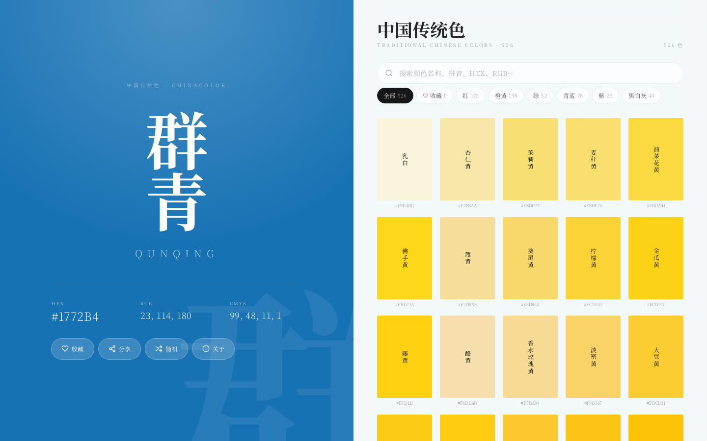
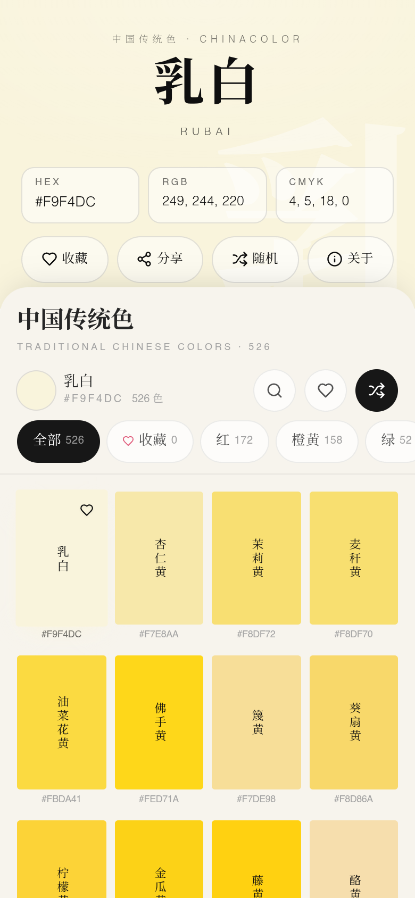

<div align="center">

# ChinaColor

**Traditional Chinese Colors**

[简体中文](./README.md) · English

[](https://chinacolor.openserve.cloud)

Live demo: <https://chinacolor.openserve.cloud>

| Desktop 1440 × 900 | Mobile 390 × 844 |
| :---: | :---: |
| <a href="docs/preview-desktop.png"></a> | <a href="docs/preview-mobile.png"></a> |

(Click a preview to open it full size.)

</div>

## Project Overview

ChinaColor is an interactive web application dedicated to showcasing and preserving the aesthetics of traditional Chinese colors. It provides an immersive platform for users to explore a rich palette of traditional Chinese hues, understand their cultural significance, and obtain detailed color values (HEX, RGB, CMYK). Built with the latest React 18, TypeScript, Vite 5, and Tailwind CSS, with lightweight CSS motion for fluid transitions, the project aims to revive classical charm with modern technology.

No installation needed — open [chinacolor.openserve.cloud](https://chinacolor.openserve.cloud) in any browser. The mobile layout is tuned for one-handed use, so all 500+ colours are comfortable to browse.

## Key Features

*   **Immersive Color Display**: Presents traditional Chinese colors in an artistic manner, with each color offering a unique visual experience.
*   **Detailed Color Information**: Provides the name, Pinyin, HEX, RGB, and CMYK values for each color, convenient for designers and developers.
*   **One-Click Copy**: Tap a HEX / RGB / CMYK value to copy it to the clipboard.
*   **Mobile First**: A compact hero, a sticky filter bar and touch targets of at least 40px keep all 500+ colors comfortable in one hand; desktop keeps the two-column layout.
*   **Adaptive Text Colour**: Every swatch and the hero pick dark or white text from WCAG relative luminance, so pale colours such as 月白 stay readable.
*   **Favourites**: Star colours, keep them in local storage and filter down to favourites only.
*   **Sharing**: Uses the native share sheet where available, otherwise copies a `?color=` deep link that opens straight on that colour.
*   **Colour Families**: Colours are grouped into red / orange-yellow / green / cyan-blue / purple / neutral from their HSL values.
*   **Shortcuts & CSS Variables**: Arrow keys step through colours, `R` picks at random, `F` favourites, `/` focuses search, and every colour can be copied as a CSS custom property.
*   **Lightweight Motion**: CSS transitions on the cards and a single hero animation instead of an animation library mounted on hundreds of cards.

## Technology Stack

| Technology         | Description                                                              |
| :----------------- | :----------------------------------------------------------------------- |
| **React 18**       | A declarative, efficient, and flexible JavaScript library for building user interfaces. |
| **TypeScript**     | A superset of JavaScript that adds static type definitions, enhancing code maintainability. |
| **Vite 5**         | A next-generation frontend tooling that provides an extremely fast development experience. |
| **Tailwind CSS**   | A utility-first CSS framework for rapidly building custom designs.        |
| **Lucide React**   | A modern, lightweight, and open-source icon library.                     |

## Getting Started

### Prerequisites

Please ensure you have Node.js (v18+ recommended) and npm or yarn installed in your development environment.

### Installation

```bash
cd chinaColor
npm install
# or
yarn install
```

### Running the Project

```bash
npm run dev
# or
yarn dev
```

The project will run on a local development server, typically at `http://localhost:5173`.

### Building the Project

```bash
npm run build
# or
yarn build
```

The built files will be output to the `dist` directory.
