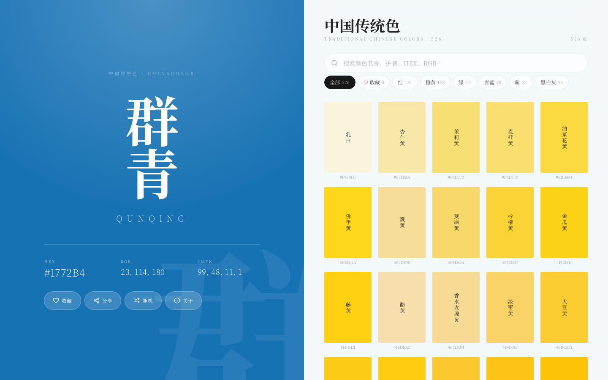
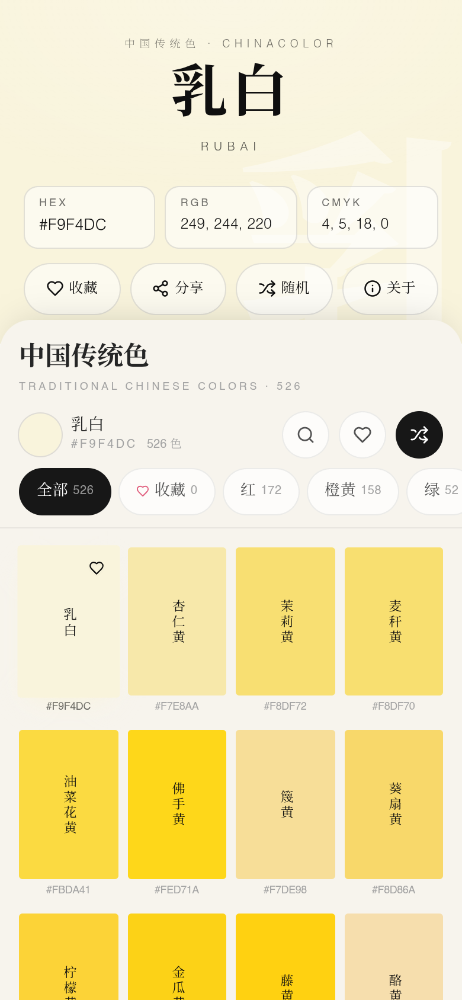

<div align="center">

# ChinaColor

**中国传统色彩 · Traditional Chinese Colors**

[](https://chinacolor.openserve.cloud)

在线体验 · Live Demo：<https://chinacolor.openserve.cloud>

</div>

## 简体中文

### 项目概述

ChinaColor 是一个致力于展示和传承中国传统色彩美学的交互式 Web 应用。它提供了一个沉浸式的平台，让用户可以探索丰富多彩的中国传统颜色，了解其文化内涵，并获取详细的色彩数值（HEX, RGB, CMYK）。项目采用最新的 React 18、TypeScript、Vite 5 和 Tailwind CSS 构建，并以轻量的 CSS 动画呈现流畅的过渡，旨在以现代技术重现古典韵味。

### 在线体验

无需安装，浏览器打开 [chinacolor.openserve.cloud](https://chinacolor.openserve.cloud) 即可使用；手机端按单手操作优化，500 多种颜色也能随手翻阅。

| 桌面端 1440 × 900 | 手机端 390 × 844 |
| :---: | :---: |
|  |  |

### 主要特性

*   **沉浸式色彩展示**：以艺术化的方式呈现中国传统颜色，每个颜色都配有独特的视觉体验。
*   **详细色彩信息**：提供每个颜色的名称、拼音、HEX、RGB 和 CMYK 值，方便设计师和开发者使用。
*   **一键复制功能**：点按 HEX / RGB / CMYK 数值即可复制到剪贴板。
*   **手机端优先**：顶部色卡区紧凑、筛选条吸顶、主要按钮触控区不小于 40px，单手即可浏览 500 多种颜色；桌面端保留左右双栏。
*   **自适应文字颜色**：按 WCAG 相对亮度为每个色块挑选深色或白色文字，浅色的精白、月白也能看清竖排色名。
*   **收藏**：一键收藏喜欢的颜色，保存在浏览器本地，并可切换「只看收藏」。
*   **分享**：优先调起系统分享面板，不支持时复制带 `?color=` 的直达链接；打开链接即定位到该颜色。
*   **色系筛选**：按 HSL 自动归入红 / 橙黄 / 绿 / 青蓝 / 紫 / 黑白灰。
*   **快捷操作与 CSS 变量**：键盘 `↑ ↓ ← →` 切色、`R` 随机一色、`F` 收藏、`/` 搜索，并可一键复制全站 CSS 变量。
*   **轻量动效**：色卡使用 CSS 过渡，主色区切换保留平滑动画，不再为数百张卡片挂载动画库。

### 技术栈

| 技术         | 描述                                     |
| :----------- | :--------------------------------------- |
| **React 18** | 用于构建用户界面的声明式、高效、灵活的 JavaScript 库。 |
| **TypeScript** | JavaScript 的超集，提供静态类型检查，增强代码可维护性。 |
| **Vite 5**   | 极速的下一代前端开发与构建工具。         |
| **Tailwind CSS** | 实用至上的 CSS 框架，快速构建自定义设计。 |
| **Lucide React** | 现代化、轻量级的开源图标库。             |

### 快速开始

#### 环境要求

请确保您的开发环境已安装 Node.js (推荐 v18+) 和 npm 或 yarn。

#### 安装依赖

```bash
cd chinaColor
npm install
# 或者
yarn install
```

#### 运行项目

```bash
npm run dev
# 或者
yarn dev
```

项目将在本地开发服务器上运行，通常是 `http://localhost:5173`。

#### 构建项目

```bash
npm run build
# 或者
yarn build
```

构建后的文件将输出到 `dist` 目录。

## English

### Project Overview

ChinaColor is an interactive web application dedicated to showcasing and preserving the aesthetics of traditional Chinese colors. It provides an immersive platform for users to explore a rich palette of traditional Chinese hues, understand their cultural significance, and obtain detailed color values (HEX, RGB, CMYK). Built with the latest React 18, TypeScript, Vite 5, and Tailwind CSS, with lightweight CSS motion for fluid transitions, the project aims to revive classical charm with modern technology.

### Try It Online

No installation needed — open [chinacolor.openserve.cloud](https://chinacolor.openserve.cloud) in any browser. The mobile layout is tuned for one-handed use, so all 500+ colours are comfortable to browse.

| Desktop 1440 × 900 | Mobile 390 × 844 |
| :---: | :---: |
|  |  |

### Key Features

*   **Immersive Color Display**: Presents traditional Chinese colors in an artistic manner, with each color offering a unique visual experience.
*   **Detailed Color Information**: Provides the name, Pinyin, HEX, RGB, and CMYK values for each color, convenient for designers and developers.
*   **One-Click Copy**: Tap a HEX / RGB / CMYK value to copy it to the clipboard.
*   **Mobile First**: A compact hero, a sticky filter bar and touch targets of at least 40px keep all 500+ colors comfortable in one hand; desktop keeps the two-column layout.
*   **Adaptive Text Colour**: Every swatch and the hero pick dark or white text from WCAG relative luminance, so pale colours such as 月白 stay readable.
*   **Favourites**: Star colours, keep them in local storage and filter down to favourites only.
*   **Sharing**: Uses the native share sheet where available, otherwise copies a `?color=` deep link that opens straight on that colour.
*   **Colour Families**: Colours are grouped into red / orange-yellow / green / cyan-blue / purple / neutral from their HSL values.
*   **Shortcuts & CSS Variables**: Arrow keys step through colours, `R` picks at random, `F` favourites, `/` focuses search, and every colour can be copied as a CSS custom property.
*   **Lightweight Motion**: CSS transitions on the cards and a single hero animation instead of an animation library mounted on hundreds of cards.

### Technology Stack

| Technology         | Description                                                              |
| :----------------- | :----------------------------------------------------------------------- |
| **React 18**       | A declarative, efficient, and flexible JavaScript library for building user interfaces. |
| **TypeScript**     | A superset of JavaScript that adds static type definitions, enhancing code maintainability. |
| **Vite 5**         | A next-generation frontend tooling that provides an extremely fast development experience. |
| **Tailwind CSS**   | A utility-first CSS framework for rapidly building custom designs.        |
| **Lucide React**   | A modern, lightweight, and open-source icon library.                     |

### Getting Started

#### Prerequisites

Please ensure you have Node.js (v18+ recommended) and npm or yarn installed in your development environment.

#### Installation

```bash
cd chinaColor
npm install
# or
yarn install
```

#### Running the Project

```bash
npm run dev
# or
yarn dev
```

The project will run on a local development server, typically at `http://localhost:5173`.

#### Building the Project

```bash
npm run build
# or
yarn build
```

The built files will be output to the `dist` directory.
